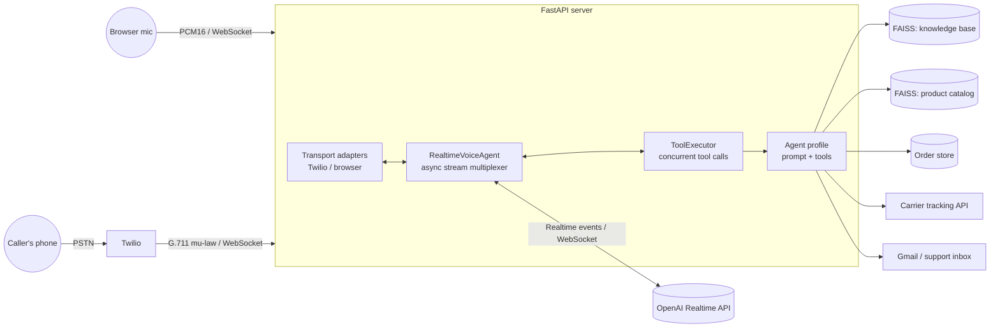

# Realtime Voice Agent: Phone Calls with LLM Tool Use

[](https://github.com/shelenderrkumar/Twilio-OpenAI-Realtime-Voice-Bot/actions/workflows/ci.yml)


A speech-to-speech AI agent you can **call on a real phone number** or talk to from a
browser. It holds a natural, interruptible conversation, calls tools while it talks
(order tracking, a shopping cart, retrieval over company documents) and answers in
**English or Urdu**.

Built on the **OpenAI Realtime API**, **Twilio Media Streams**, **FastAPI** and
**LangChain** tools with **FAISS** retrieval.

---

## Why this is interesting

Classic voice bots chain three models: speech-to-text, an LLM and text-to-speech.
Each hop adds latency, and the pipeline loses tone, hesitation and the ability to be
interrupted. This project uses a single **speech-to-speech** model instead, which brings
its own systems problems:

- Audio arrives as a continuous stream from the caller while the model streams audio
  back and requests tool calls, all **at the same time**.
- The caller can **interrupt** (barge in) mid-sentence.
- Tool calls such as HTTP lookups or vector search must run **without blocking the audio**.
- Context grows with every audio turn, so cost and latency grow during long calls.

## Architecture



**Lifecycle of one call**

1. Twilio receives a call and requests `POST /incoming-call`. The server returns TwiML that
   opens a bidirectional **Media Stream** to `wss://<host>/media-stream`.
2. `RealtimeVoiceAgent.run` opens a WebSocket to the Realtime API and sends a
   `session.update` with the persona's instructions, tool JSON-schemas and audio format.
3. Three async streams are merged (`voicebot/realtime/streams.py`): **caller audio**,
   **model events** and **finished tool results**. Whichever produces an event first
   is handled first.
4. When the model emits `response.function_call_arguments.done`, the call is queued in the
   `ToolExecutor` and runs as its own task, so the audio loop never waits on I/O.
   Its result is sent back as a `function_call_output` and the model continues speaking.
5. When the caller hangs up (`stop`), the merge ends and every connection and task is
   cleaned up.

## Engineering decisions

| Problem | Approach | Where |
|---|---|---|
| Latency of transcoding | The audio format is negotiated per transport (G.711 mu-law for phones, PCM16 for browsers). Payloads pass straight through and are never decoded on the server. | `realtime/agent.py` |
| Barge-in | Server-side VAD detects `speech_started`. The server sends Twilio a `clear` event so queued agent audio stops immediately. | `server.py` |
| Concurrent tool calls | Calls go into an `asyncio.Queue` and run as independent tasks. Results stream back in completion order. Two simultaneous calls are fine; the original version raised "already in progress". | `realtime/executor.py` |
| Robustness | A failing tool, unknown tool name or malformed JSON arguments becomes an error message *to the model*, which recovers conversationally instead of dropping the call. | `realtime/executor.py` |
| Growing context | Sliding window over audio items: older items are deleted server-side (`conversation.item.delete`), so cost per turn stays bounded. | `realtime/agent.py` |
| Noisy spoken product names | Embedding search with two thresholds: a confident match, *"did you mean ...?"* suggestions, or not found. | `services/catalog.py` |
| Digits read one by one | Tracking numbers are normalized ("three nine seven ...", spaces, dashes). | `services/tracking.py` |
| Privacy on an open phone line | Anyone who knows a tracking number can call, so carrier-API responses are stripped of names, phones and addresses before reaching the model. | `services/tracking.py` |
| Webhook spoofing | Optional `X-Twilio-Signature` verification. | `server.py` |
| Least privilege | Gmail uses the `gmail.send` scope only, not full mailbox access. | `services/notifier.py` |
| Per-caller state | Each call builds its own profile, so carts and "promotion already offered" flags never leak between callers. | `profiles/` |

## Two agent personas

Pick one with `AGENT_PROFILE`:

| `logistics` (default) | `grocery` |
|---|---|
| Bilingual (English / Urdu) courier support line | Voice shopping assistant with a live cart UI |
| `track_shipment`: carrier API or local orders | `add_to_cart`, `change_item_quantity`, `remove_from_cart` |
| `search_knowledge_base`: RAG over `data/knowledge_base/*.md` | `check_item_availability`, `get_cart_summary` (51-item catalog) |
| optional Tavily web search | `get_promotion` (once per call), `place_order`, `track_order`, `submit_complaint` |

Adding a persona means writing a prompt and a list of LangChain `@tool` functions in
`voicebot/profiles/`. The realtime engine is domain-agnostic.

## Quick start

```bash
git clone https://github.com/shelenderrkumar/Twilio-OpenAI-Realtime-Voice-Bot.git
cd Twilio-OpenAI-Realtime-Voice-Bot
python -m venv .venv && source .venv/bin/activate
pip install -e ".[dev]"
cp .env.example .env          # add your OPENAI_API_KEY
python main.py                # http://localhost:5050
```

**Talk from the browser:** open <http://localhost:5050>, click the microphone and speak.
For the grocery cart UI, set `AGENT_PROFILE=grocery`.

**Call it on a phone:**

```bash
ngrok http 5050                            # note the https forwarding host
# in .env: PUBLIC_HOST=<that host>, TWILIO_AUTH_TOKEN=<your token>
```

In the Twilio console, set your number's *A call comes in* webhook to
`https://<PUBLIC_HOST>/incoming-call` and call the number.

**Docker:** `docker build -t voice-agent . && docker run --env-file .env -p 5050:5050 voice-agent`

The FAISS indexes for the catalog and knowledge base are built from `data/` on first use
and cached in `data/indexes/`. You can also build them ahead of time with
`python scripts/build_indexes.py`.

## Testing

```bash
pytest -q        # 38 tests, no API keys or network needed
ruff check .
```

The suite includes an **end-to-end phone-call test** (`tests/test_server.py`). A scripted
fake of the Realtime API drives a real FastAPI WebSocket session through:

> Twilio `start` → caller audio → barge-in `clear` → model requests a tool → tool runs →
> `function_call_output` + `response.create` → agent audio streamed back to Twilio → `stop`.

Other tests cover the stream multiplexer's shutdown, concurrent and failing tool calls,
cart arithmetic and validation, PII stripping, Twilio signature rejection, and that every
tool produces a valid Realtime JSON schema. CI runs lint and tests on Python 3.10 and 3.12
and builds the Docker image.

## Project layout

```
voicebot/
  server.py            FastAPI routes, Twilio <-> Realtime event translation
  config.py            typed settings (pydantic-settings, .env)
  dependencies.py      lazily-built shared services
  realtime/
    agent.py           session config + event loop
    executor.py        concurrent, fault-tolerant tool execution
    streams.py         async stream merge with early stop
    client.py          Realtime WebSocket client
  profiles/            personas: logistics.py, grocery.py
  services/            cart, catalog (FAISS), knowledge_base (FAISS), orders, tracking, notifier
data/                  product catalog, demo orders, knowledge-base documents (fictional company)
static/                browser client (AudioWorklet mic capture and playback)
tests/                 pytest suite
```

## Limitations and future work

- **Evaluation:** there is no automatic benchmark yet. Next steps: measure
  time-to-first-audio and tool-call accuracy over a set of recorded calls, and compare
  speech-to-speech against a cascaded STT → LLM → TTS baseline.
- **Interruption accuracy:** on barge-in, the server clears Twilio's buffer but does not
  yet truncate the model's own transcript of the unspoken audio (`conversation.item.truncate`).
- **Code-switching:** callers in Pakistan mix Urdu and English within a sentence; how
  well the model's ASR and turn detection handle this is an open question.
- **Persistence:** orders live in a CSV file for the demo; production would use a database.
- **API version:** targets the Realtime API beta event schema (`OpenAI-Beta: realtime=v1`).

## Acknowledgements

The tool-calling loop started from LangChain's
[react-voice-agent](https://github.com/langchain-ai/react-voice-agent) example, and the
browser AudioWorklets come from Azure-Samples
[aisearch-openai-rag-audio](https://github.com/Azure-Samples/aisearch-openai-rag-audio).
The demo company "NovaShip Logistics" and its documents are fictional.

## License

[MIT](LICENSE)
